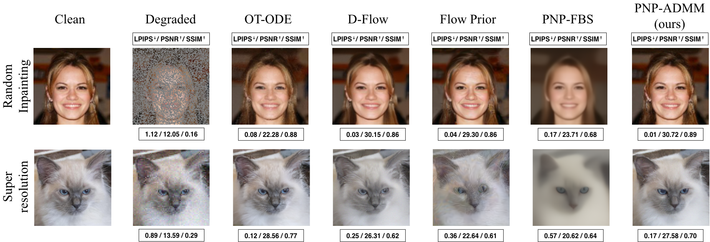

# Flow-Guided Plug-and-Play ADMM for Inverse Problems in Imaging

This repository contains the implementation of **PnP-Flow-ADMM**, a method for solving inverse problems using **Plug-and-Play (PnP) priors with flow matching models**, optimized via **ADMM (Alternating Direction Method of Multipliers)**.

Our implementation is adapted from the PnP-Flow (ICLR 2025) codebase, which is based on a Forward-Backward Splitting (FBS) formulation.

---

## Overview

Inverse problems aim to recover signals from degraded measurements and are typically ill-posed.
Plug-and-Play (PnP) methods address this by integrating pretrained generative priors, with recent work leveraging efficient flow matching models.
However, existing PnP approaches can push iterates away from the learned flow trajectories, reducing the effectiveness of the prior.

We propose **PnP-Flow-ADMM**, a framework that improves the integration of flow priors within PnP methods.

**Our contributions include:**

* **ADMM-based optimization with flow priors** for better data–prior consistency
* **Trajectory correction mechanism** to keep iterates aligned with flow dynamics
* **Improved efficiency** with fewer denoiser evaluations and lower runtime

<p align="center">
  
</p>

---

## Requirements

* Python ≥ 3.9
* torch ≥ 1.13.1
* torchvision
* numpy
* scipy
* tqdm
* pandas
* pyyaml
* torchdiffeq
* deepinv

---

## Download Datasets and Pretrained Models

We provide a `download.sh` script to download datasets and pretrained flow-matching checkpoints from Google Drive.

Install dependency (if needed):

```bash
pip install gdown
```

---

### Usage

```bash
bash download.sh <option>
```

Available options:

```bash
celeba-dataset
afhq-cat-dataset
pretrained-network-celeba
pretrained-network-afhq-cat
```

---

### Output Structure

* **CelebA**

  * Dataset: `data/celeba/`
  * Model: `model/celeba/ot/model_final.pt`

* **AFHQ-Cat**

  * Dataset: `data/afhq_cat/`
  * Model: `model/afhq_cat/ot/model_final.pt`

---

## Solving Inverse Problems

This project supports the following inverse problems:

* **Denoising** - `denoising`
* **Gaussian Deblurring** - `gaussian_deblurring_FFT`
* **Super-resolution** - `superresolution`
* **Box Inpainting** - `inpainting`
* **Random Inpainting** - `random_inpainting`
* **Paintbrush Inpainting** - `paintbrush_inpainting`

---

### Available Methods

To run a specific method, you must pass its name using the `method` argument.

* `pnp_flow_admm` — **Proposed method**
* `pnp_flow_fbs`
* `ot_ode`
* `d_flow`
* `flow_priors`

---

### Example Run

```bash
python main.py --opts \
    dataset celeba \
    train False \
    eval True \
    problem inpainting \
    method pnp_flow_admm
```

---

You can replace `dataset celeba` with:

* `dataset afhq_cat` (for AFHQ-Cat)

Replace `problem` and `method` with the desired options from the lists above.

---

## Hyperparameters (PnP-ADMM)

The key hyperparameters for the `pnp_flow_admm` method are:

* `steps_pnp` — Number of ADMM iterations (default: 200)
* `rho_admm` — ADMM penalty parameter controlling data–prior balance (default: 1000)
* `max_cgiter` — Maximum number of conjugate gradient iterations (default: 10)
* `cg_tol` — Tolerance for the CG solver (default: 1e-5)
* `save_norms_admm` — Store ADMM residual norms (default: False)

### Projection Settings

* `adaptive_noise=True` — **Adaptive projection (recommended)**
* `adaptive_noise=False`, `deterministic_noise=True` — Deterministic projections
* `adaptive_noise=False`, `deterministic_noise=False` — Random projections

---

## Evaluation

We provide a script to reproduce the main results, including **quantitative evaluation, runtime, and memory measurements**.

Experiments are run across:

* Datasets: `celeba`, `afhq_cat`
* Inverse problems: denoising, deblurring, super-resolution, inpainting, random-inpainting and paintbrush-inpainting
* Methods: OT-ODE, Flow Prior, D-Flow, PNP-Flow-FBS, PNP-Flow-ADMM

Each run processes batches of size 4 and evaluates performance over 25 batches.

---

### Run All Experiments

```bash
bash scripts/main_results.sh
```

---

### Experiment Details

* Random starting batch per run
* Evaluation over **25 batches**
* Runtime and GPU memory recorded
* Results averaged across batches
* Same setup across all methods
* Reported time/memory metrics are computed using this script

---

## Project Structure

```
├── config/          # Configuration files
├── data/            # Datasets
├── model/           # Pretrained and trained models
├── results/         # Output results
├── scripts/         # Bash scripts for experiments
├── main.py          # Main entry point
```

---

## License

This project is licensed under the **BSD 3-Clause License**.
This repository builds upon the PnP-Flow codebase.
See the `LICENSE` file for details.

---

## Acknowledgements

This repository builds upon the following works:

* PnP-Flow (ICLR 2025)
* GSPnP
* DeepInv
* Rectified Flow

We thank the authors for making their code publicly available.
