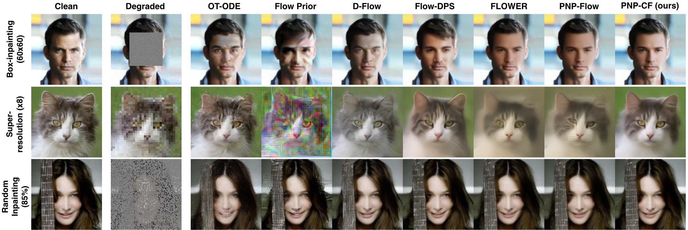

# PnP-CF: A Consensus Flow-Matching Solver for General Inverse Problems

This repository contains the implementation of **PnP-CF (Consensus Flow)**, a flow-matching Plug-and-Play solver for general inverse problems. PnP-CF combines an ADMM-like variable-splitting scheme with dual-variable updates and a time-adaptive stochastic–deterministic pullback that repeatedly realigns the iterate with the learned flow trajectory.

Our implementation is adapted from the PnP-Flow (ICLR 2025) codebase, which is based on a Forward-Backward Splitting (FBS) formulation.

---

## Overview

Inverse problems aim to recover an unknown signal from degraded or incomplete measurements and are often ill-posed. Plug-and-Play (PnP) methods address this by combining a forward-model consistency step with a learned image prior. When a flow-matching model is used as the prior, the forward-consistency update can move the current iterate away from the intermediate probability path on which the flow model was trained.

**PnP-CF** addresses this interaction through two complementary mechanisms:

* **ADMM-like consensus updates:** a scaled dual variable accumulates disagreement between the forward-consistent and prior-consistent solutions and feeds this discrepancy back into subsequent updates.
* **Time-adaptive trajectory pullback:** the pullback combines a stochastic component for exploration with a trajectory-dependent deterministic component for refinement, gradually shifting from stochastic exploration to trajectory-consistent updates.
* **General forward operators:** linear problems use conjugate gradients for the forward-consistency subproblem, while differentiable nonlinear operators are handled with gradient-based updates without backpropagating through the flow denoiser.
* **Neural-network forward models:** the framework also supports segmentation-guided reconstruction using a pretrained segmentation network as a highly non-injective forward operator.

<p align="center">
  
</p>

---

## Requirements

Clone the repository and install the required dependencies:

```bash
pip install -r requirements.txt
```

This will install all the necessary Python packages required to run the project.


---

## Download Datasets and Pretrained Models

We provide `scripts/download.sh` to download the datasets and pretrained checkpoints used by the code.

Install `gdown` if needed:

```bash
pip install gdown
```

CelebA-HQ is downloaded through the Kaggle API, so install and configure `kaggle` before using the corresponding option:

```bash
pip install kaggle
```

### Usage

```bash
bash scripts/download.sh <option>
```

Available options:

```bash
celeba-dataset
afhq-cat-dataset
celebahq-dataset
pretrained-network-celeba
pretrained-network-afhq-cat
pretrained-network-celebahq
deblur_model
```

### Output Structure

* **CelebA**
  * Dataset: `data/celeba/`
  * Flow model: `model/celeba/ot/model_final.pt`

* **AFHQ-Cat**
  * Dataset: `data/afhq_cat/`
  * Flow model: `model/afhq_cat/ot/model_final.pt`

* **CelebA-HQ / CelebAMask-HQ**
  * Dataset: `data/celebahq/`
  * Segmentation and fine-tuned prior checkpoints: `model/celeba_hq/`

* **Nonlinear deblurring model**
  * KernelWizard GOPRO-wVAE checkpoint: `model/deblur_model/`

---

## Solving Inverse Problems

The current implementation supports both linear and nonlinear forward operators.

### Inverse Problems Evaluated in the Paper

* **Box inpainting** — `inpainting`
* **Random inpainting** — `random_inpainting`
* **Super-resolution** — `superresolution`
* **Phase retrieval** — `phase_retrieval`
* **HDR reconstruction** — `hdr_reconstruction`
* **Nonlinear deblurring** — `nonlinear_deblurring`
* **Segmentation-guided reconstruction** — `segmentation`

---

### Available Methods

Pass the solver name through the `method` argument:

* `pnp_cf` — **PnP-CF (proposed method)**
* `pnp_flow_fbs` — PnP-Flow
* `flow_dps` — FlowDPS
* `d_flow` — D-Flow
* `flower` — FLOWER
* `ot_ode` — OT-ODE
* `flow_priors` — Flow Priors

For nonlinear forward operators, the implementation supports `pnp_cf`, `pnp_flow_fbs`, `d_flow`, and `flow_dps`. `ot_ode`, `flow_priors`, and `flower` are restricted to linear forward operators in this repository.


---

### Example Run

```bash
python main.py --opts \
    dataset celeba \
    model ot \
    train False \
    eval True \
    eval_split test \
    problem inpainting \
    method pnp_cf
```

You can replace `dataset`, `problem`, and `method` with the desired options listed above.

---

## Hyperparameters (PnP-CF)

The main PnP-CF hyperparameters are:

* `steps_pnp` — number of PnP-CF iterations `K`
* `rho_admm` — base ADMM penalty controlling consensus between forward- and prior-consistent updates
* `beta_rho` — penalty-growth exponent in `rho_k = rho / (1 - t_k)^beta`; set `beta_rho=0` for constant `rho`
* `t_schedule_gamma` — trajectory schedule exponent in `t_k = (k/K)^gamma`
* `num_denoiser_calls` — number of flow-denoiser evaluations averaged per iteration
* `admm_gd_steps` — number of inner gradient-based forward-consistency steps for nonlinear operators

The paper uses task-specific values for these parameters and the optimal values are given in the appendix of paper. 
The script files `run_all.sh` and `run_seg.sh` contain the settings used for the reported evaluations.

### Pullback Settings

* `adaptive_noise=True` — **time-adaptive stochastic–deterministic pullback**
* `adaptive_noise=False`, `deterministic_noise=True` — deterministic-only pullback
* `adaptive_noise=False`, `deterministic_noise=False` — stochastic-only pullback

The stochastic-only and deterministic-only variants are used for the ablation experiments.

---

## Evaluation

The main experiments evaluate **100 test images** from CelebA (`128×128`) and AFHQ-Cat (`256×256`). For image reconstruction we report **PSNR**, **SSIM**, and **LPIPS**. Segmentation-guided reconstruction additionally evaluates consistency with the target mask using **mIoU**.

Results are saved under:

```text
results/<dataset>/<model>/<problem>/<method>/<eval_split>/
```

Runtime and peak GPU-memory measurements can be enabled with `compute_time=True` and `compute_memory=True`.

---

### Run the Experiment Suite

The repository contains scripts for the paper experiments and ablations.

Full linear/nonlinear benchmark and method comparisons:

```bash
MAX_BATCH=25 BATCH_SIZE_IP=4 bash scripts/run_all.sh
```

Schedule-free PnP-CF experiments:

```bash
bash scripts/run_default_params.sh
```

Segmentation-guided reconstruction:

```bash
bash scripts/run_seg.sh
```


---

### Experiment results and Analysis

We provide the Jupyter notebook `graphs.ipynb` for plotting optimization behavior, and summarizing quantitative results.
Ensure that the evaluation scripts have been run beforehand so that the corresponding results are available in the `results/` directory.

---

<!-- ## Project Structure

```
├── config/          # Dataset and method configuration files
├── data/            # Datasets
├── model/           # Pretrained and trained models
├── pnpflow/         # PnP-CF, baselines, operators, and utilities
├── results/         # Reconstruction and evaluation outputs
├── scripts/         # Download, evaluation, ablation, and sweep scripts
├── main.py          # Main entry point
```

--- -->

<!-- ## License

This project is licensed under the **BSD 3-Clause License**.
This repository builds upon the PnP-Flow codebase.
See the `LICENSE` file for details.

--- -->

## Acknowledgements

This repository builds upon the following works:

* PnP-Flow (ICLR 2025)
* GSPnP
* DeepInv
* Rectified Flow

We thank the authors for making their code publicly available.
